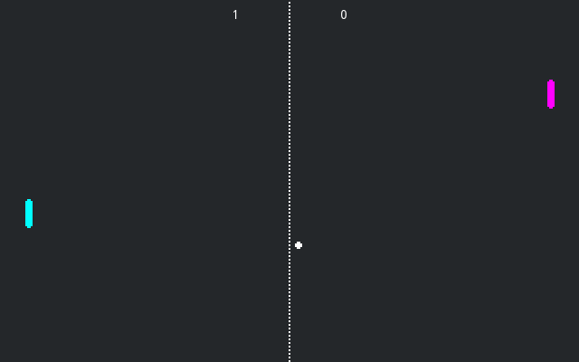

# Pong Multiplayer

A multiplayer implementation of the classic pong game.
One of the players should press **Host**, while the other
should type in the host's IP address and press **Join**.

Rust port of the upstream Godot demo; the game logic lives in [`../rust/src`](../rust/src).

Language: Rust (via [godot-rust](https://github.com/godot-rust/gdext))

Renderer: Compatibility

Upstream GDScript demo: [networking/multiplayer_pong](https://github.com/godotengine/godot-demo-projects/tree/master/networking/multiplayer_pong)

## Screenshots

